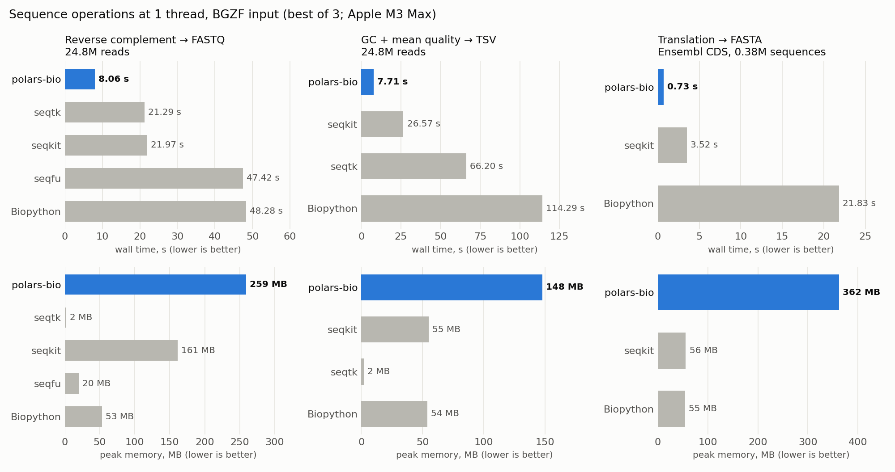

# polars-bio 0.38.0: Sequence Operations, DataFusion 55.2, and Smaller, Faster Wheels

polars-bio 0.38.0 adds a `seq` namespace to Polars expressions: reverse
complement, GC content, translation, mean quality and more, running as native
Polars plugins. At one thread they are **2.1–3.6× faster than seqkit** on
FASTQ and 4.3–4.8× faster on translation. At 8 threads on BGZF input, GC
content and mean quality run **24× faster than seqkit**, and reverse complement
12× faster. All of them match
seqkit and Biopython on golden test corpora. The release also
moves to DataFusion 55.2, makes plain-gzip FASTQ reads about 2× faster, and builds
the PyPI wheels with fat link-time optimisation: **30% smaller and up to 14% faster**.

<!-- more -->

## Sequence operations as Polars expressions

Until now, transforming sequences in polars-bio meant leaving the query engine:
a `map_elements` or `map_batches` callback into Python, or a round trip through
another tool. 0.38.0 adds the operations people reach for in
[seqkit](https://github.com/shenwei356/seqkit) and
[seqfu](https://github.com/telatin/seqfu2) as Polars expressions. Importing
`polars_bio` registers `pl.Expr.seq`:

```python
import polars as pl
import polars_bio as pb  # registers pl.Expr.seq

reads = (
    pb.scan_fastq("reads.fastq.gz")
    .with_columns(
        gc=pl.col("sequence").seq.gc_content(),
        qual=pl.col("quality_scores").seq.mean_quality(),
    )
    .filter((pl.col("gc") > 0.4) & (pl.col("qual") >= 20))
    .collect(engine="streaming")
)
```

| Expression | What it computes | Matches |
|---|---|---|
| `.seq.revcomp(alphabet="dna", strict=False)` | reverse complement | seqkit `seq -r -p`, seqfu `rc`, seqtk `seq -r`, Biopython |
| `.seq.reverse()` | reversed string, e.g. a FASTQ quality alongside `revcomp` | Polars `str.reverse()`, much faster on ASCII |
| `.seq.complement(alphabet="dna", strict=False)` | complement, not reversed | Biopython `complement` |
| `.seq.gc_content(denominator="length")` | GC fraction, 0 to 1 | seqkit `fx2tab -B GC`; with `"acgt"`, seqkit `fx2tab -g` |
| `.seq.translate(frame=1, table=1, to_stop=False)` | protein translation, frames ±1–3, every NCBI table | Biopython `Seq.translate`, seqkit `translate` |
| `.seq.mean_quality(offset=33, method="error_prob")` | mean Phred quality | seqkit `fx2tab -q`; `"arithmetic"` is FastQC's mean |

A few properties worth knowing:

- **They are native Polars plugins**, compiled into the polars-bio extension
  module. They run without the GIL, in parallel, and stream with
  `collect(engine="streaming")` or `sink_*`.
- **They work on any String column**, not only on frames from polars-bio readers.
- **Nulls stay nulls**, and a ratio with nothing to divide by (an empty read)
  gives null rather than NaN, so `pl.col("gc") > 0.3` drops it instead of keeping
  it. Polars orders NaN above every number.
- **The same kernels are available in SQL** as `seq_revcomp`, `seq_reverse`,
  `seq_complement`, `seq_gc_content`, `seq_translate` and `seq_mean_quality`:

```python
pb.register_fastq("reads.fastq.gz", "reads")
pb.sql(
    "SELECT name, seq_gc_content(sequence) AS gc, "
    "seq_translate(sequence, -1) AS aa FROM reads"
).collect()
```

A reverse-complemented FASTQ, with the quality string reversed alongside it, is
one short pipeline:

```python
lf = pb.scan_fastq("reads.fastq.gz").with_columns(
    sequence=pl.col("sequence").seq.revcomp(),
    quality_scores=pl.col("quality_scores").seq.reverse(),
)
pb.sink_fastq(lf, "reads.rc.fastq")
```

`.seq.reverse()` exists because Polars' own `str.reverse()` reverses Unicode
grapheme clusters, which is correct for text but slow for quality strings. On
4.25M reads at one thread, adding `str.reverse()` to a FASTQ scan took the
pipeline from 1.67 s to 4.20 s; `.seq.reverse()` costs about 0.2 CPU-seconds and
doesn't change the wall time.

### Correctness first

The kernels live in a new upstream crate,
`datafusion-bio-function-seq`, and are checked against seqkit 2.14.0 and Biopython
1.88 on golden corpora: every IUPAC code in both cases, every NCBI translation
table, all six frames, `to_stop` on and off. Every polars-bio output in the
benchmarks below was also checked against seqkit's.

Where the reference tools disagree, polars-bio follows one of them and says so
in the docs. For example, for an ambiguous codon such as `RAT` (D or N),
Biopython returns `B`, while seqkit and polars-bio return `X`. The corpus also
turned up a seqkit 2.14.0 bug: `seqkit translate` reverses but doesn't complement
IUPAC ambiguity codes in negative frames, so `RTT` at frame −1 becomes `K`
instead of `N`. polars-bio agrees with Biopython there.

## Benchmarks against seqkit, seqtk, seqfu and Biopython

Three pipelines, each producing the same file from the same input:

| Operation | polars-bio | seqkit | seqtk | seqfu | Biopython |
|---|---|---|---|---|---|
| Reverse complement → FASTQ | `.seq.revcomp()` + `.seq.reverse()`, `sink_fastq` | `seq -r -p` | `seq -r` | `rc` | `FastqGeneralIterator` + `reverse_complement()` |
| GC % + mean quality → TSV | `.seq.gc_content("acgt")`, `.seq.mean_quality()`, `sink_csv` | `fx2tab -g -q` | `comp` | — | `FastqGeneralIterator` + Python loop |
| Translation → FASTA | `.seq.translate()`, `sink_fasta` | `translate` | — | — | `translate()` |

Inputs are public FASTQ runs of 0.72M (DRR609229), 4.25M (ERR5897746), 24.8M
(DRR013000) and 64.3M (SRR39421268) reads, and the Ensembl GRCh38 CDS FASTA
(0.38M sequences), each as BGZF and as plain gzip. Every tool runs with one
thread (`-j 1`, `POLARS_MAX_THREADS=1`, `target_partitions=1`) as a fresh
process. Wall time is the best of three runs; CPU time is from that run, and
peak memory is the highest of the three. For the two Python tools, wall and CPU
time exclude interpreter start-up and imports, but peak memory includes them.
Biopython runs on the three smaller FASTQ files only.

The machine was an Apple M3 Max (16 cores, 64 GB) running macOS 15.7, with
seqkit 2.14.0, seqtk 1.5, seqfu 1.30.3, Biopython 1.88 and Polars 2.1.0, and a
fat-LTO build of polars-bio master at the 0.38.0 feature freeze. polars-bio's
reverse complement and translation runs use the same build plus the faster
FASTQ and FASTA writer from
[datafusion-bio-formats#276](https://github.com/biodatageeks/datafusion-bio-formats/pull/276),
described under [Multiple threads](#multiple-threads); GC + quality writes
through Polars' own `sink_csv`, which that change doesn't touch. It wasn't
otherwise idle (3–4.5 of 16 cores busy with background work), but seqkit's
repeated runs agreed within a few percent.

### One thread



**Reverse complement → FASTQ** (wall s / CPU s / peak MB):

| Reads | Input | polars-bio | seqkit | seqtk | seqfu | Biopython |
|---|---|---|---|---|---|---|
| 0.72M | BGZF | **0.21 / 0.3 / 176** | 0.53 / 0.5 / 138 | 0.63 / 0.6 / 2 | 1.46 / 1.7 / 20 | 1.37 / 1.4 / 50 |
| | gzip | **0.22 / 0.4 / 173** | 0.47 / 0.5 / 75 | 0.61 / 0.6 / 2 | 1.57 / 1.6 / 14 | 1.31 / 1.3 / 44 |
| 4.25M | BGZF | **1.69 / 2.5 / 208** | 5.10 / 5.1 / 162 | 4.79 / 4.8 / 2 | 9.12 / 11.5 / 20 | 9.58 / 9.6 / 51 |
| | gzip | **1.92 / 2.7 / 179** | 4.74 / 4.7 / 75 | 4.87 / 4.8 / 2 | 10.62 / 10.6 / 14 | 9.34 / 9.3 / 46 |
| 24.8M | BGZF | **8.06 / 11.5 / 259** | 21.97 / 21.9 / 161 | 21.29 / 21.2 / 2 | 47.42 / 57.4 / 20 | 48.28 / 48.0 / 53 |
| | gzip | **9.09 / 12.4 / 230** | 20.71 / 20.7 / 75 | 21.35 / 21.2 / 2 | 55.41 / 55.0 / 14 | 46.00 / 45.7 / 48 |
| 64.3M | BGZF | **19.72 / 30.4 / 300** | 58.08 / 56.9 / 162 | 59.35 / 58.2 / 2 | 126.54 / 151.1 / 20 | — |
| | gzip | **22.30 / 33.1 / 277** | 55.61 / 54.9 / 75 | 59.09 / 57.9 / 2 | 149.40 / 146.9 / 14 | — |

**GC % + mean quality → TSV** (wall s / CPU s / peak MB):

| Reads | Input | polars-bio | seqkit | seqtk | Biopython |
|---|---|---|---|---|---|
| 0.72M | BGZF | **0.19 / 0.4 / 139** | 0.65 / 0.6 / 53 | 1.77 / 1.8 / 2 | 3.37 / 3.4 / 52 |
| | gzip | **0.21 / 0.4 / 138** | 0.61 / 0.6 / 57 | 1.76 / 1.7 / 2 | 3.32 / 3.3 / 47 |
| 4.25M | BGZF | **1.60 / 2.6 / 140** | 5.74 / 5.7 / 54 | 13.34 / 13.3 / 2 | 27.96 / 27.9 / 53 |
| | gzip | **1.81 / 2.8 / 141** | 5.44 / 5.4 / 57 | 13.37 / 13.3 / 2 | 27.64 / 27.6 / 46 |
| 24.8M | BGZF | **7.71 / 12.4 / 148** | 26.57 / 26.5 / 55 | 66.20 / 65.9 / 2 | 114.29 / 114.1 / 54 |
| | gzip | **8.77 / 13.4 / 143** | 25.56 / 25.5 / 57 | 69.28 / 68.9 / 2 | 114.28 / 114.1 / 47 |
| 64.3M | BGZF | **18.75 / 33.0 / 159** | 66.03 / 65.9 / 55 | 187.21 / 185.9 / 2 | — |
| | gzip | **21.48 / 35.5 / 146** | 62.83 / 62.7 / 58 | 183.63 / 182.5 / 2 | — |

**Translation → FASTA**, Ensembl CDS (wall s / CPU s / peak MB):

| Input | polars-bio | seqkit | Biopython |
|---|---|---|---|
| BGZF | **0.73 / 1.1 / 362** | 3.52 / 3.5 / 56 | 21.83 / 21.8 / 55 |
| gzip | **0.78 / 1.2 / 360** | 3.37 / 3.3 / 57 | 21.49 / 21.4 / 50 |

**Wall time.** polars-bio is the fastest tool in every case: 2.1–2.9× faster
than the next tool on reverse complement, 2.9–3.6× on GC + quality, and
4.3–4.8× faster than seqkit on translation.

**CPU time.** polars-bio's "one thread" uses 1.4–1.9 cores: the reader decodes
the next batch while Polars processes the current one. Counted by CPU time, it
still uses 45–60% of seqkit's on the 4.25M-read and larger files, 31–35% on
translation, and 56–76% on the smallest file.

**Memory is the trade-off.** polars-bio peaks at 140–300 MB on FASTQ and about
360 MB on translation, against 53–162 MB for seqkit, 44–55 MB for Biopython,
14–20 MB for seqfu and 2 MB for seqtk, which streams one record at a time.
polars-bio's figure includes the Python interpreter with Polars, PyArrow and
DataFusion loaded. It grows slowly with the input (on reverse complement from
about 175 MB at 0.72M reads to 300 MB at 64.3M, a 90-fold larger file) because
the data is processed in batches rather than loaded whole.

### Multiple threads

seqkit, seqtk, seqfu and Biopython process records one at a time, and only
seqkit has a thread option. For these three subcommands `seqkit -j 8` helps
only on plain gzip FASTQ input (1.7–2×, presumably by decompressing in a
separate thread). On BGZF input it is no faster. polars-bio splits BGZF input
into partitions and processes them in parallel, so we ran its three pipelines
at 1, 2, 4 and 8 threads, setting `POLARS_MAX_THREADS` and polars-bio's
`datafusion.execution.target_partitions` together.


**polars-bio wall time in seconds, BGZF input** (peak memory at 8 threads in
the last column):

| Operation | Reads | 1 | 2 | 4 | 8 | Speed-up | Peak MB at 8 |
|---|---|---|---|---|---|---|---|
| GC + mean quality → TSV | 0.72M | 0.19 | 0.10 | 0.06 | **0.05** | 3.9× | 272 |
| | 4.25M | 1.60 | 0.78 | 0.40 | **0.24** | 6.6× | 323 |
| | 24.8M | 7.71 | 3.75 | 1.90 | **1.10** | 7.0× | 397 |
| | 64.3M | 18.75 | 8.99 | 4.62 | **2.98** | 6.3× | 445 |
| Reverse complement → FASTQ | 0.72M | 0.21 | 0.11 | 0.08 | **0.08** | 2.8× | 538 |
| | 4.25M | 1.69 | 0.82 | 0.42 | **0.35** | 4.8× | 1299 |
| | 24.8M | 8.06 | 3.88 | 2.30 | **1.90** | 4.2× | 1421 |
| | 64.3M | 19.72 | 9.95 | 5.45 | **5.68** | 3.5× | 1926 |
| Translation → FASTA | Ensembl CDS | 0.73 | 0.74 | 0.75 | 0.76 | 1.0× | 802 |

**seqkit wall time in seconds, `-j 1` → `-j 8`:**

| Operation | Reads | BGZF | gzip |
|---|---|---|---|
| GC + mean quality | 24.8M | 26.71 → 27.00 | 25.55 → 12.67 |
| | 64.3M | 66.15 → 67.42 | 63.17 → 32.07 |
| Reverse complement | 24.8M | 22.41 → 22.66 | 21.25 → 12.52 |
| | 64.3M | 58.95 → 60.26 | 55.53 → 30.14 |
| Translation | Ensembl CDS | 3.52 → 3.57 | 3.36 → 2.99 |

**GC content and mean quality scale 6–7×.** The reader, the `.seq` kernels
and Polars all run in parallel, and Polars' own `sink_csv` writes the result.
At 8 threads polars-bio processes 24.8M reads in 1.10 s, against 27.0 s for
seqkit, and 64.3M reads in 2.98 s.

**Reverse complement now scales 3.5–4.8× on 4.25M reads and up.** In 0.37.0 it stopped at about
2× (3.29 s on 24.8M reads and 10.23 s on 64.3M at 8 threads, the dotted line
in the figure). Reading and transforming scaled: without the write, reverse
complement of 24.8M reads took 1.02 s at 8 threads. But `pb.sink_fastq` wrote
the output on one thread, through an 8 KiB buffer and a record object per read,
and that writer topped out at about 3.3 s. In 0.38.0 the writer
([datafusion-bio-formats#276](https://github.com/biodatageeks/datafusion-bio-formats/pull/276))
formats each Arrow batch straight into a 4 MiB buffer, with byte-identical
output, and uses 9–19% less CPU time than 0.37.0's writer even at one thread.

Writing is still done on one thread, and beyond 4 threads it is the limit
again: the 24.8M-read output is 5.17 GB, and just writing that many bytes to
this machine's SSD takes 0.85–0.97 s. Outside the benchmark harness the best
8-thread run took 1.31 s, and repeated runs vary between 1.3 and 1.9 s
depending on how much of the previous run's output macOS is still flushing to
disk. On 64.3M reads, 8 threads are no faster than 4. Peak memory at 8 threads
is 1.3–1.9 GB on 4.25M reads and up (reading alone peaks at about 250 MB). It is
held in the handoff from Polars to the writer, which is the next thing to fix.

**Translation doesn't scale yet.** The Ensembl CDS file is read as one stream
(0.60 s to read at 1 and at 8 threads), so the FASTA reader is the limit here,
not the kernels.

**Plain gzip never scales** for polars-bio: a gzip stream can only be
decompressed from start to end, on one thread. At 8 threads it is still
1.3–1.5× faster than `seqkit -j 8` on gzip (for example 8.78 s against
12.67 s for GC + quality on 24.8M reads). For multi-threaded work, compress
with `bgzip` instead of `gzip`: BGZF is still gzip-compatible.

!!! warning "Read order with more than one partition"
    polars-bio's default, `target_partitions=1`, reads the file as one
    partition and writes reads in their input order, even with Polars using
    every core. With `target_partitions` above 1, `pb.sink_fastq` writes the
    same reads, but their order can change from run to run. Keep the default
    when order matters, for example for paired-end files that must stay in
    step.

### Plain gzip: 35–49% faster in this release

Plain gzip (not BGZF) can't be split, so it is always read as one stream. Before
this release that stream went through an asynchronous path that awaited every
record, and polars-bio was about 1.8× slower on gzip than on BGZF.
[datafusion-bio-formats#275](https://github.com/biodatageeks/datafusion-bio-formats/pull/275)
moves plain gzip, BGZF without a `.gzi` index, and uncompressed single-partition
FASTQ to the synchronous batch loop that the parallel BGZF path already used,
decompressing with `flate2`'s multi-member decoder on zlib-rs.

At the reader level (4.25M reads, one partition):

| Input | Before #275 | After #275 |
|---|---|---|
| plain gzip | 4.09–4.38 s | **2.03–2.08 s** |
| BGZF without `.gzi` | 2.11–2.22 s | 1.82–1.90 s |
| uncompressed | 1.19–1.20 s | 0.77–0.80 s |

End to end, at one thread on plain gzip (wall / CPU seconds):

| Pipeline | Reads | Before #275 | After #275 | Change | seqkit |
|---|---|---|---|---|---|
| Reverse complement → FASTQ | 4.25M | 3.21 / 4.7 | **1.90 / 3.4** | −41% | 4.9–5.0 / 4.9–5.0 |
| | 24.8M | 15.12 / 21.1 | **9.89 / 15.7** | −35% | 22.0–22.7 / 22.0–22.4 |
| GC + mean quality → TSV | 4.25M | 3.00 / 4.1 | **1.90 / 2.9** | −37% | 5.4–5.6 |
| | 24.8M | 14.51 / 19.8 | **8.76 / 13.5** | −40% | 26.1 |
| | 64.3M | 41.51 / 54.5 | **21.13 / 35.1** | −49% | 63–65 / 63 |

Gzip input is now only 5–15% slower than BGZF for polars-bio (see the tables
above), and polars-bio uses less CPU time than seqkit on gzip as well as less
wall time. The before/after numbers in this table come from a separate A/B run
of the two builds.

## DataFusion 55.2

polars-bio moves from DataFusion 53.0 to **55.2.0**, together with
datafusion-python 55.0, PyO3 0.29, Arrow 59.3 and the 55.x releases of
`datafusion-bio-formats` (v1.16.1) and `datafusion-bio-functions` (v0.26.0).

- **Upgrade `datafusion` together with polars-bio.** The Python requirement is
  now `datafusion>=55.0.0,<56`.
- **External sorts no longer fail with `Resources exhausted`** when several
  partitions sort at once under `FairSpillPool`
  ([apache/datafusion#20642](https://github.com/apache/datafusion/pull/20642)).
- **Grouped aggregations need a little more memory before they can spill.** With
  `datafusion.runtime.memory_limit` at 2 MB, a 1M-group aggregation now fails
  instead of spilling; from 4 MB up it spills and completes as before.
- **Remote reads that fail mid-stream** (a truncated body, a timeout or a
  connection reset) now return an error instead of retrying forever.
- **Building from source needs Rust 1.95** or newer.

We re-ran the interval benchmarks on 0.37.0, on the DataFusion 55 build, and on
the DataFusion 55 build with fat LTO (10 runs × 4 rounds). All three are within
±2%:

| Case | 0.37.0 | DataFusion 55 | DataFusion 55 + LTO |
|---|---|---|---|
| `count_overlaps` 8-7, 1 thread | 0.940 s | 0.939 s | 0.925 s |
| `count_overlaps` 8-7, 8 threads | 0.165 s | 0.165 s | 0.165 s |
| `coverage` 8-0, 1 thread | 0.668 s | 0.670 s | 0.674 s |
| `coverage` 8-0, 8 threads | 0.152 s | 0.149 s | 0.147 s |

## Smaller, faster wheels: stripping and fat LTO

The DataFusion 55 bump and the new plugin pushed the Linux aarch64 wheel to
95.4 MiB, within 5 MiB of PyPI's default 100 MiB per-file limit. Two build
changes bring it well clear:

- **Stripped symbols** (`strip = "symbols"`) remove about 11–15 MiB from each
  wheel. Native panic backtraces now show addresses instead of function names.
- **Fat link-time optimisation with one codegen unit**, in a new `dist` build
  profile used for the PyPI wheels.

Measured on macOS arm64, all builds stripped, median of three runs:

| Build | Wheel | Runtime vs stripped baseline | Build time |
|---|---|---|---|
| Stripped baseline | 79.5 MB | — | 7.5 min |
| Thin LTO | 82.3 MB (+3.5%) | −8% on BAM and VCF at 1 thread | 10.8 min |
| **Fat LTO** (`dist`) | **55.5 MB (−30%)** | **−10…−14% BAM, −12% VCF, −5% FASTQ** at 1 thread | ~24 min |

Fat LTO is both the smallest and the fastest build, but it costs about three
times the build time. So it runs only for release tags, a weekly scheduled build
and manual runs. Pull requests keep the faster stripped `release` profile.
`maturin develop --release` is unchanged; `maturin build --profile dist` builds a
wheel like the published one.

**The Linux aarch64 wheel's link needs about 34 GiB** with fat LTO, against 12 GiB
on macOS arm64. That doesn't fit on GitHub's 16 GB ARM runners, so the release
wheel is cross-compiled on a self-hosted x86_64 runner with swap, then installed
and tested on a native ARM runner. It is now tagged `manylinux_2_28` (glibc
2.28) instead of `manylinux2014`, matching the aarch64 wheels of pyarrow and
datafusion, which polars-bio already requires.

## Also in 0.38.0

- **`pb.set_progress_bar(False)`** turns off polars-bio's processed-rows progress
  bar at any time, also after `polars_bio` is imported, without silencing other
  `tqdm` bars ([#504](https://github.com/biodatageeks/polars-bio/issues/504)).
- **`df.config_meta` no longer keeps large frames alive** until the cyclic garbage
  collector runs. In a 10 × 160 MB loop the peak memory fell from 1.7 GB to
  0.33 GB ([#503](https://github.com/biodatageeks/polars-bio/issues/503)).

## Try it

```bash
pip install -U "polars-bio==0.38.0"
```

The [Sequence operations guide](../../features/sequences.md) covers semantics,
alphabets and translation in detail, and the
[API reference](../../api/sequences.md) lists every parameter. The benchmark
harness and the raw results (every run, with provenance and input checksums)
are in
[polars-bio-bench](https://github.com/biodatageeks/polars-bio-bench/tree/master/results/seqops-expressions-20261116-0909).
