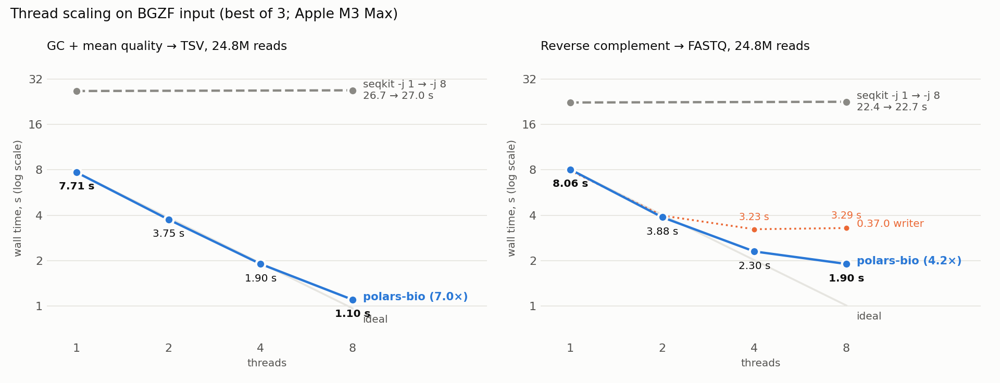

# polars-bio 0.38.0: Sequence Operations, DataFusion 55.2, and Smaller, Faster Wheels

polars-bio 0.38.0 adds sequence operations as Polars expressions: reverse
complement, GC content, translation, mean quality and more. At one thread they
are **2.1–3.6× faster than seqkit** on FASTQ and **4.3–4.8× faster** on
translation, and at 8 threads GC content runs **24× faster than seqkit**. The
release also moves to DataFusion 55.2, reads plain gzip FASTQ about 2× faster, and
ships wheels that are **30% smaller and up to 14% faster**.

<!-- more -->

## Sequence operations as Polars expressions

Importing `polars_bio` registers a `.seq` namespace on every Polars expression:

```python
import polars as pl
import polars_bio as pb  # registers pl.Expr.seq

reads = (
    pb.scan_fastq("reads.fastq.gz")
    .with_columns(
        gc=pl.col("sequence").seq.gc_content(),
        qual=pl.col("quality_scores").seq.mean_quality(),
    )
    .filter((pl.col("gc") > 0.4) & (pl.col("qual") >= 20))
    .collect(engine="streaming")
)
```

| Expression | What it computes |
|---|---|
| `.seq.revcomp()` | reverse complement |
| `.seq.reverse()` | reversed string, e.g. a FASTQ quality alongside `revcomp` |
| `.seq.complement()` | complement, not reversed |
| `.seq.gc_content()` | GC fraction, 0 to 1 |
| `.seq.translate()` | protein translation, frames ±1–3, every NCBI table |
| `.seq.mean_quality()` | mean Phred quality |

They are native Polars plugins: they run in parallel without the GIL, stream,
and work on any String column. The same functions are available in SQL as
`seq_revcomp`, `seq_gc_content`, `seq_translate` and so on. Results match seqkit
2.14.0 and Biopython 1.88 on golden test corpora.

## Benchmarks

Three pipelines, each producing the same file with every tool: reverse
complement → FASTQ, GC % + mean quality → TSV, and translation → FASTA. Inputs
are public FASTQ runs of 24.8M and 64.3M reads and the Ensembl GRCh38 CDS
(0.38M sequences), BGZF-compressed. The machine was an Apple M3 Max; wall time is
the best of three runs.

### One thread


**Wall time in seconds, one thread:**

| Pipeline | Reads | polars-bio | seqkit | seqtk | seqfu | Biopython |
|---|---|---|---|---|---|---|
| Reverse complement | 24.8M | **8.06** | 21.97 | 21.29 | 47.42 | 48.28 |
| | 64.3M | **19.72** | 58.08 | 59.35 | 126.54 | 144.07\* |
| GC + mean quality | 24.8M | **7.71** | 26.57 | 66.20 | — | 114.29 |
| | 64.3M | **18.75** | 66.03 | 187.21 | — | 380.41 |
| Translation | 0.38M | **0.73** | 3.52 | — | — | 21.83 |

\* Measured in a later run on a busier machine (seqkit took 18% longer there), so
likely a little slow.

polars-bio is the fastest tool on every pipeline. The price is memory: it peaks at
140–360 MB, against 2–160 MB for the other tools, which process one record at a
time.

### Multiple threads



**Wall time in seconds, 24.8M reads:**

| Pipeline | polars-bio, 1 → 8 threads | seqkit, `-j 1` → `-j 8` | At 8 threads |
|---|---|---|---|
| GC + mean quality | 7.71 → **1.10** (7.0×) | 26.71 → 27.00 | **24× faster** |
| Reverse complement | 8.06 → **1.90** (4.2×) | 22.41 → 22.66 | **12× faster** |

polars-bio reads BGZF files in parallel partitions, so these pipelines scale
with threads. seqkit's `-j` doesn't speed up these subcommands on BGZF input.
Plain gzip can only be decompressed on one thread, so compress with `bgzip` for
multi-threaded work.

## Plain gzip about 2× faster

Plain gzip FASTQ is now decoded on a faster path. At one thread on 24.8M reads,
reverse complement went from 15.1 s to 9.9 s and GC + quality from 14.5 s to
8.8 s. Gzip input is now within 5–15% of BGZF.

## DataFusion 55.2

polars-bio moves from DataFusion 53.0 to **55.2.0**, with datafusion-python 55.0
and Arrow 59.3. Upgrade `datafusion` together with polars-bio: the requirement is
now `datafusion>=55.0.0,<56`. External sorts no longer fail with
`Resources exhausted` when several partitions sort at once, and remote reads that
fail mid-stream now return an error instead of retrying forever. Interval
operations run at the same speed as in 0.37.0.

## Smaller, faster wheels

The PyPI wheels are now stripped and built with fat link-time optimisation. On
macOS arm64, against a stripped build without LTO:

| | Without LTO | 0.38.0 wheel (fat LTO) |
|---|---|---|
| Wheel size | 79.5 MB | **55.5 MB (−30%)** |
| BAM scan, 1 thread | baseline | **10–14% faster** |
| VCF scan, 1 thread | baseline | **12% faster** |
| FASTQ scan, 1 thread | baseline | **5% faster** |

## Also in 0.38.0

- **`pb.set_progress_bar(False)`** turns off polars-bio's progress bar at any
  time ([#504](https://github.com/biodatageeks/polars-bio/issues/504)).
- **`df.config_meta` no longer keeps large frames alive**: in a 10 × 160 MB loop
  peak memory fell from 1.7 GB to 0.33 GB
  ([#503](https://github.com/biodatageeks/polars-bio/issues/503)).

## Try it

```bash
pip install -U "polars-bio==0.38.0"
```

The [Sequence operations guide](../../features/sequences.md) and the
[API reference](../../api/sequences.md) cover every function. The benchmark
harness and raw results are in
[polars-bio-bench](https://github.com/biodatageeks/polars-bio-bench/tree/master/results/seqops-expressions-20261116-0909).
